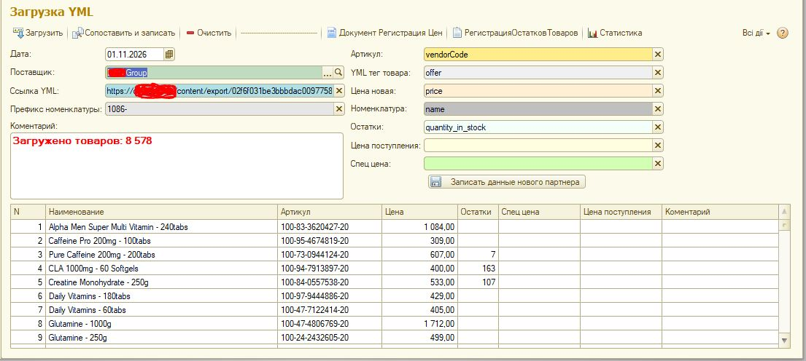

# YML_Price_Loader
 Автоматическая загрузка цен и остатков поставщиков из формата YML/XML в 1С УТ3.1
# Модуль YML-интеграции (YML Price Loader) для 1С:Предприятие 8.3 / BAS

Этот модуль предназначен для автоматизации процесса загрузки цен и остатков товаров от поставщиков в конфигурации 1С:Предприятие 8.3 / BAS (УТ 3.1, УТП, Бухгалтерия, Small-business). 

Поставщики часто предоставляют прайс-листы в формате YML (Yandex Market Language) или XML. Ручное обновление таких файлов — долгий и трудоемкий процесс. Данный модуль позволяет автоматизировать загрузку, настроить сопоставление номенклатуры и обновлять цены по расписанию.

## 🎯 Решенные задачи (Бизнес-ценность)
*   **Автоматизация:** Замена ручного обновления прайсов на автоматический регламентный процесс.
*   **Гибкость:** Поддержка различных форматов XML/YML (с разными тегами для цен и остатков).
*   **Сопоставление данных:** Механизм поиска и привязки товаров поставщика к внутреннему справочнику "Номенклатура" по артикулу.
*   **Актуальность цен:** Автоматическое обновление регистров сведений (цены поставщиков) и документов.
*   **Обработка ошибок:** Устойчивость к поврежденным файлам и некорректным данным.

## 🛠 Технический стек
*   **Платформа:** 1С:Предприятие 8.3 (управляемые формы).
*   **Язык:** Встроенный язык 1С.
*   **Технологии:** 
    *   Чтение и разбор XML-документов.
    *   Работа с файловой системой.
    *   Работа со справочниками, документами и регистрами сведений.
    *   Создание регламентных заданий.

## 🚀 Как это работает
1.  **Получение файла:** Модуль считывает YML/XML файл из указанной папки (или получает по URL).
2.  **Парсинг:** XML-документ разбирается на узлы (`<offer>`, `<price>`, `<quantity>`, `<vendorCode>`).
3.  **Поиск номенклатуры:** Для каждого товара из файла выполняется поиск в справочнике "Номенклатура" по артикулу.
4.  **Обновление данных:** 
    *   Если товар найден — обновляется регистр сведений "Цены поставщиков" и остатки.
    *   Если товар не найден — он записывается в лог ошибок.
5.  **Формирование отчета:** После завершения загрузки формируется отчет о количестве обновленных позиций.
